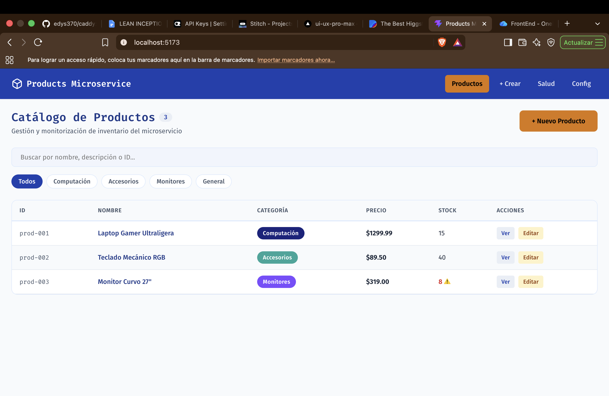
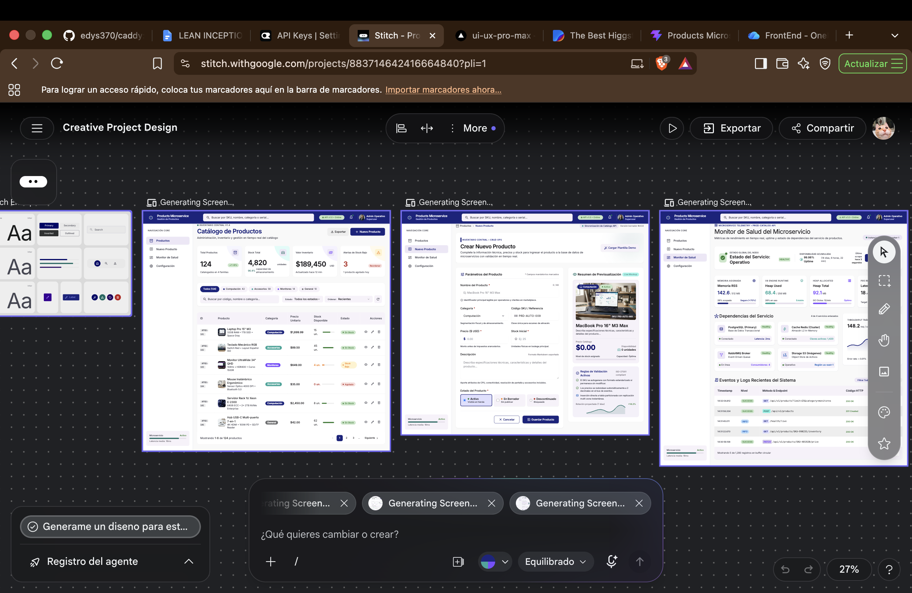
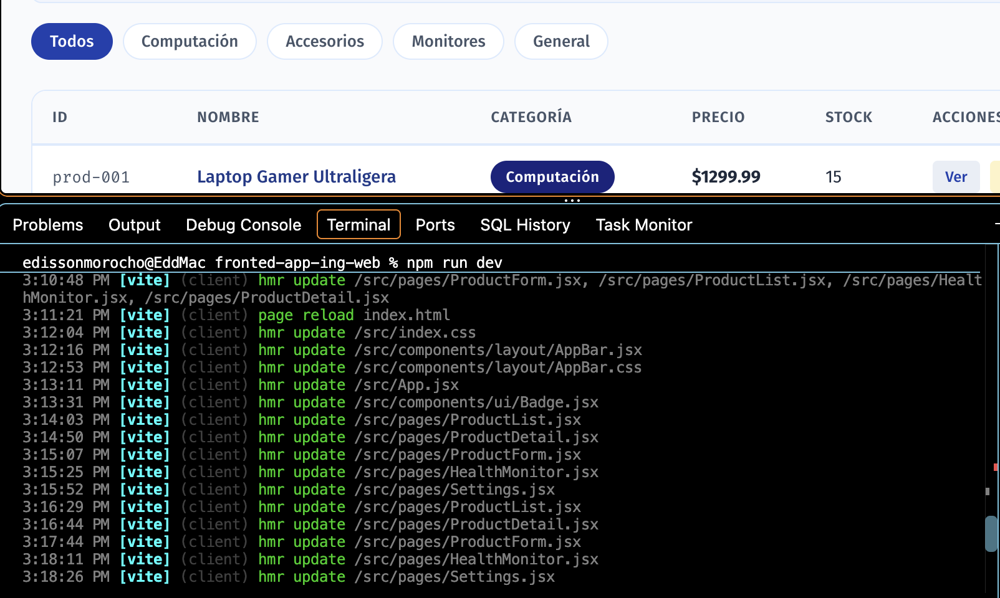
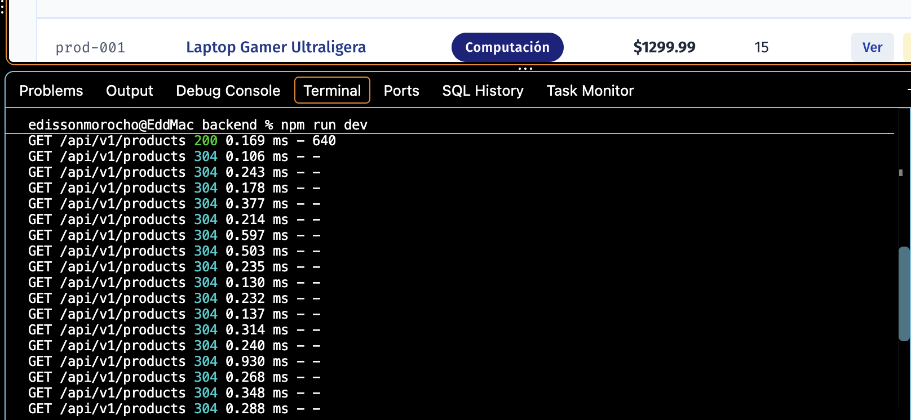
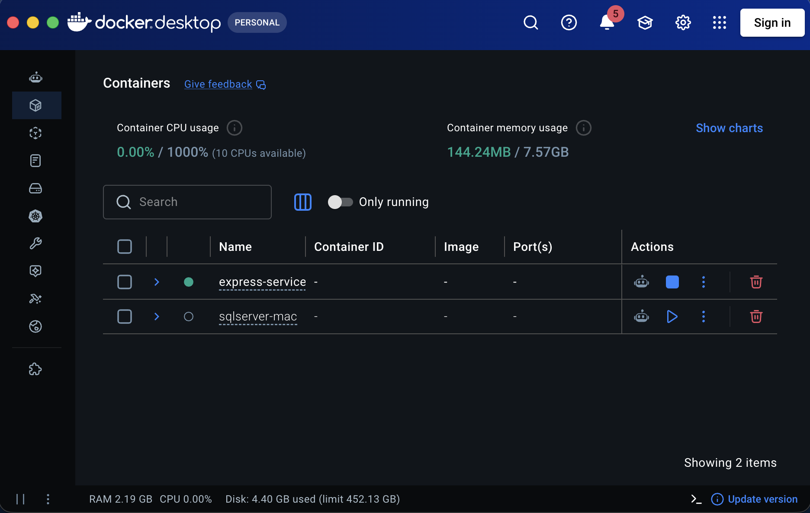

# 📦 Products Microservice & Dashboard Web

Proyecto integral de microservicio de catálogo de productos construido con arquitectura en capas en **Node.js + Express**, soporte para contenedores **Docker**, proxy inverso con **Caddy**, y una interfaz moderna en **React + Vite** basada en el sistema de diseño de **Google Stitch** y Material Design 3.

---

## 📸 Evidencias de Funcionamiento

A continuación se presentan las capturas de pantalla que demuestran la correcta implementación, diseño y funcionamiento tanto del frontend como del backend y la orquestación:

### 1. Interfaz de Usuario y Catálogo (Frontend)

| 🖥️ Dashboard en Ejecución | 🎨 Diseño de Google Stitch |
| :---: | :---: |
|  |  |
| *Catálogo interactivo con filtros por categoría, búsqueda y badges.* | *Diseño base y tokens visuales generados con Google Stitch.* |

---

### 2. Diagnóstico y Pruebas de Red

| 🌐 Peticiones HTTP OK en Frontend | ⚙️ Parámetros y Diagnóstico de Conexión |
| :---: | :---: |
|  |  |
| *Inspección de red en DevTools con respuestas HTTP 200 OK del microservicio.* | *Pantalla de configuración y prueba de latencia / ping exitosa al backend.* |

---

### 3. Backend, Terminal y Contenedores

| 📡 Peticiones OK en Terminal Backend | 🐳 Contenedores Docker & Caddy Proxy |
| :---: | :---: |
|  |  |
| *Servidor Node.js escuchando y registrando logs de peticiones entrantes.* | *Contenedores `products-api` y `caddy-proxy` activos y saludables.* |

---

## 📁 Estructura del Repositorio

```text
PracticasWeb/
├── Docs/
│   └── Capturas/                      # Evidencias fotográficas del proyecto
│       ├── dasbordEjecutando.png
│       ├── DisenioDeGoogleSticth.png
│       ├── PeticoinesOKfront.png
│       ├── ParametrosyPrueba deConexion.png
│       ├── PeticionesOKBackTerminal.png
│       └── Docker.png
├── backend/                           # Microservicio Node.js Express + Docker
│   ├── src/
│   │   ├── config/                    # Configuración y variables de entorno
│   │   ├── controllers/               # Controladores HTTP (req, res)
│   │   ├── services/                  # Lógica de negocio desacoplada
│   │   ├── routes/                    # Rutas REST versionadas (/api/v1/products, /health)
│   │   ├── middlewares/               # Manejo de errores y 404
│   │   ├── app.js                     # Configuración Express (Helmet, CORS, Morgan)
│   │   └── server.js                  # Punto de entrada HTTP y Graceful Shutdown
│   ├── Caddyfile                      # Configuración de proxy inverso Caddy
│   ├── Dockerfile                     # Construcción de imagen de producción
│   ├── docker-compose.yml             # Orquestación de API + Caddy
│   └── package.json
└── fronted-app-ing-web/               # Frontend React 19 + Vite + Stitch Design
    ├── src/
    │   ├── api/axios.js               # Cliente HTTP Axios configurado con baseURL
    │   ├── components/                # Componentes UI (Button, Card, Badge, DataTable, Dialog)
    │   ├── pages/                     # Páginas (ProductList, ProductDetail, ProductForm, Health, Settings)
    │   └── styles/                    # Tokens CSS de Stitch (variables.css)
    ├── .env                           # Configuración VITE_API_URL
    └── package.json
```

---

## 🚀 Guía de Ejecución

### Prerrequisitos
- **Node.js** (v18 o superior)
- **npm**
- **Docker** y **Docker Compose** (opcional para ejecución en contenedores)

---

### Opción A: Ejecución en Local (Desarrollo)

#### 1. Iniciar el Backend
```bash
cd backend
npm install
npm run dev
```
- API disponible en: `http://localhost:3001`
- Verificación de salud: `http://localhost:3001/health`
- Catálogo de productos: `http://localhost:3001/api/v1/products`

#### 2. Iniciar el Frontend
En otra terminal:
```bash
cd fronted-app-ing-web
npm install
npm run dev
```
- Aplicación web accesible en: `http://localhost:5173`

---

### Opción B: Ejecución con Docker Compose
```bash
cd backend
docker compose up -d
```
- API directa: `http://localhost:3000`
- Proxy inverso Caddy: `http://localhost:8080`

---

## 📡 Endpoints de la API REST

| Método | Endpoint | Descripción |
| :--- | :--- | :--- |
| `GET` | `/health` | Observabilidad general (uptime, RAM, entorno) |
| `GET` | `/health/live` | Liveness probe para orquestadores |
| `GET` | `/health/ready` | Readiness probe del servicio |
| `GET` | `/api/v1/products` | Obtiene lista de productos (filtros por categoría y búsqueda) |
| `GET` | `/api/v1/products/:id` | Obtiene detalle de un producto específico |
| `POST` | `/api/v1/products` | Crea un nuevo producto |
| `PUT` | `/api/v1/products/:id` | Actualiza un producto existente |
| `DELETE` | `/api/v1/products/:id` | Elimina un producto por ID |
